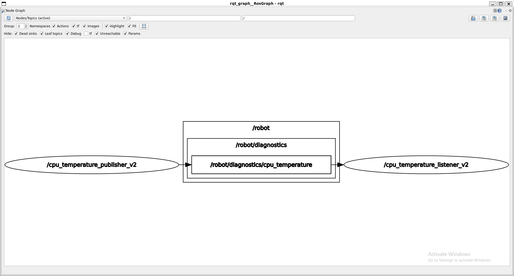
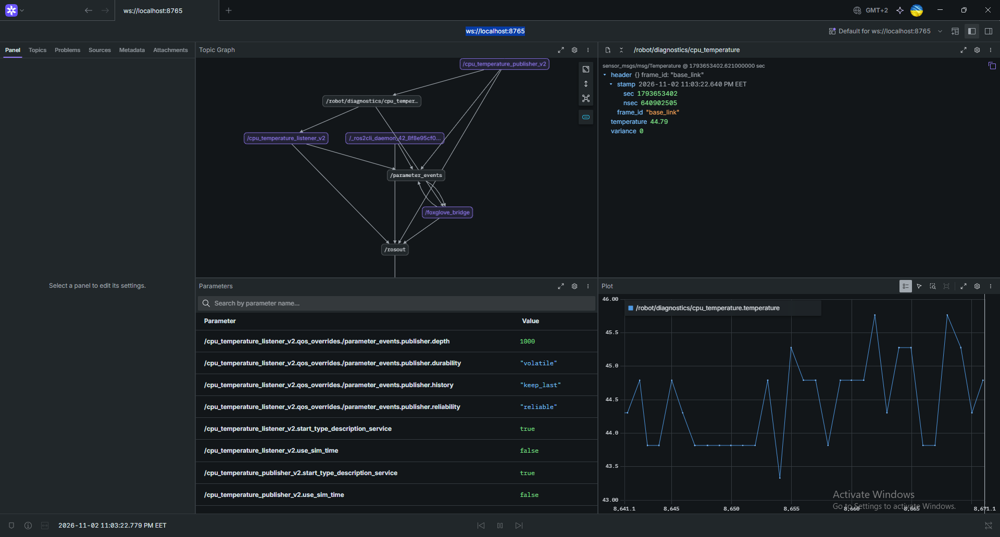

### Packages
    ros@rpi:/ros2-ws$ cd src
    ros@rpi:/ros2-ws/src$ ros2 pkg create \
        --build-type <ament_python | ament_cmake> \
        --license <license> <package_name>

example:
    
    ros@rpi:/ros2-ws/src$ ros2 pkg create --build-type ament_cmake \
        --license Apache-2.0 robot_monitor_cpp --dependencies sensor_msgs rclcpp

### build
    ros@rpi:/ros2-ws/src$ cd .. # <=== buld from workspace, not from src!
    ros@rpi:/ros2-ws$ colcon build --packages-select <packages> --symlink-install

    #for each terminal
    source install/setup.build

example:

    colcon build --packages-select robot_monitor_cpp --symlink-install
    source install/setup.bash

### run node manualy
    ros2 run <package_name> <executable>

    ros2 run robot_monitor_cpp cpu_temperature_listener_v2

### rqt_graph
    ros2 run rqt_graph rqt_graph

check `Nodes/Topics (active)` and press `Refresh button`

### run foxglove bridge
you can run the container on dev pc and run foxglove bridge on it

    ros2 run foxglove_bridge foxglove_bridge 

then open Foxglove application and open connection. if you run foxglove bridge on dev pc locally - use `ws://localhost:8765` by default. If you run foxglove bridge on raspberry pi or another device, that connected via ssh use: `ws://<DEVICE_IP_ADDRESS>:8765`

### analyze and debug
    

| bash | usage | output example |
| ---- | ----- | -------------- |
| `ros2 node list` | check running nodes | /cpu_temperature_alarm_notificator /cpu_temperature_listener_v2 /cpu_temperature_publisher_v2 /foxglove_bridge |
|`ros2 topic list` | show active topics | /parameter_events /robot/diagnostics/cpu_temperature /rosout|
|`ros2 topic list -t`| show active topics with message types| /parameter_events<>[rcl_interfaces/msg/ParameterEvent] /robot/diagnostics/cpu_temperature [sensor_msgs/msg/Temperature] /rosout [rcl_interfaces/msg/Log]
|`ros2 topic echo <topic_name>`| echo from topic|header stamp: sec: 1793648342 nanosec: 640140228 frame_id: base_link temperature: 46.738 variance: 0.0 ---
|`ros2 topic info <topic_name>`| show msg type, publisher and subscription count| Type: sensor_msgs/msg/Temperature Publisher count: 1 Subscription count: 3
| `ros2 topic info <topic_name> --verbose` | same with extra data | <pre>Type: sensor_msgs/msg/Temperature  Publisher count: 1  Node name: cpu_temperature_publisher_v2 Node namespace: / Topic type: sensor_msgs/msg/Temperature Topic type hash: RIHS01_72514a14126ab9f8a9abec974c78e5610a367b59db5da355ff1fb982d5bad4b8 Endpoint type: PUBLISHER GID: 01.0f.a2.ad.39.cc.10.1c.00.00.00.00.00.00.13.03 QoS profile:   Reliability: RELIABLE   History (Depth): KEEP_LAST (10)   Durability: VOLATILE   Lifespan: Infinite   Deadline: Infinite   Liveliness: AUTOMATIC   Liveliness lease duration: Infinite  Subscription count: 3  Node name: cpu_temperature_listener_v2 Node namespace: / Topic type: sensor_msgs/msg/Temperature Topic type hash: RIHS01_72514a14126ab9f8a9abec974c78e5610a367b59db5da355ff1fb982d5bad4b8 Endpoint type: SUBSCRIPTION GID: 01.0f.a2.ad.9a.cc.b4.68.00.00.00.00.00.00.13.04 QoS profile:   Reliability: RELIABLE   History (Depth): KEEP_LAST (10)   Durability: VOLATILE   Lifespan: Infinite   Deadline: Infinite   Liveliness: AUTOMATIC   Liveliness lease duration: Infinite  Node name: cpu_temperature_alarm_notificator Node namespace: / Topic type: sensor_msgs/msg/Temperature Topic type hash: RIHS01_72514a14126ab9f8a9abec974c78e5610a367b59db5da355ff1fb982d5bad4b8 Endpoint type: SUBSCRIPTION GID: 01.0f.a2.ad.e4.cd.40.9f.00.00.00.00.00.00.13.04 QoS profile:   Reliability: RELIABLE   History (Depth): KEEP_LAST (10)   Durability: VOLATILE   Lifespan: Infinite   Deadline: Infinite   Liveliness: AUTOMATIC   Liveliness lease duration: Infinite  Node name: foxglove_bridge Node namespace: / Topic type: sensor_msgs/msg/Temperature Topic type hash: RIHS01_72514a14126ab9f8a9abec974c78e5610a367b59db5da355ff1fb982d5bad4b8 Endpoint type: SUBSCRIPTION GID: 01.0f.a4.2c.d9.00.93.e8.00.00.01.00.00.00.70.04 QoS profile:   Reliability: RELIABLE   History (Depth): KEEP_LAST (10)   Durability: VOLATILE   Lifespan: Infinite   Deadline: Infinite   Liveliness: AUTOMATIC   Liveliness lease duration: Infinite</pre> |
`ros2 topic pub <repeat (--once) or -r <hz>> <topic_name> <msg_type> "{<msg>}"`| publish message to the topic | <pre>ros@rpi:/ros2-ws$ ros2 topic pub --once robot/diagnostics/cpu_temperature sensor_msgs/msg/Temperature "{temperature: 91.0}" publisher: beginning loop publishing #1: sensor_msgs.msg.Temperature(header=std_msgs.msg.Header(stamp=builtin_interfaces.msg.Time(sec=0, nanosec=0), frame_id=''), temperature=91.0, variance=0.0)<pre>|
`ros2 topic hz <topic_name>` | show topic message frequency | <pre>ros@rpi:/ros2-ws$ ros2 topic hz /robot/diagnostics/cpu_temperature average rate: 0.997         min: 1.003s max: 1.003s std dev: 0.00000s window: 1<pre>|