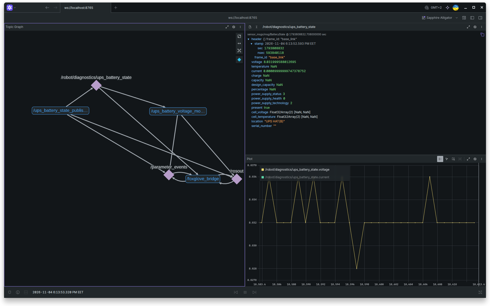

# lesson materials

to check your RPI pinout use

    user@rpi:~/ros2-practical$ pinout

output ecample:

<pre>Description        : Raspberry Pi 4B rev 1.5
Revision           : d03115
SoC                : BCM2711
RAM                : 8GB
Storage            : MicroSD
USB ports          : 4 (of which 2 USB3)
Ethernet ports     : 1 (1000Mbps max. speed)
Wi-fi              : True
Bluetooth          : True
Camera ports (CSI) : 1
Display ports (DSI): 1

,--------------------------------.
| oooooooooooooooooooo J8   +======
| 1ooooooooooooooooooo  J14 |   Net
|  Wi                    12 +======
|  Fi  Pi Model 4B  V1.5 oo      |
| |D     ,---. +---+          +====
| |S     |SoC| |RAM|          |USB3
| |I     `---' +---+          +====
| |0                C|           |
| oo1 J2            S|        +====
|                   I| |A|    |USB2
| pwr   |hd|   |hd| 0| |u|    +====
`-| |---|m0|---|m1|----|x|-------'

J8:
   3V3  (1) (2)  5V    
 GPIO2  (3) (4)  5V    
 GPIO3  (5) (6)  GND   
 GPIO4  (7) (8)  GPIO14
   GND  (9) (10) GPIO15
GPIO17 (11) (12) GPIO18
GPIO27 (13) (14) GND   
GPIO22 (15) (16) GPIO23
   3V3 (17) (18) GPIO24
GPIO10 (19) (20) GND   
 GPIO9 (21) (22) GPIO25
GPIO11 (23) (24) GPIO8 
   GND (25) (26) GPIO7 
 GPIO0 (27) (28) GPIO1 
 GPIO5 (29) (30) GND   
 GPIO6 (31) (32) GPIO12
GPIO13 (33) (34) GND   
GPIO19 (35) (36) GPIO16
GPIO26 (37) (38) GPIO20
   GND (39) (40) GPIO21

J2:
GLOBAL ENABLE (1)
          GND (2)
          RUN (3)

J14:
TR01 TAP (1) (2) TR00 TAP
TR03 TAP (3) (4) TR02 TAP</pre>

check connected i2c device address:

    badrobot@rpi:~/ros2-practical$ sudo i2cdetect -y 1

my UPS hat connected at 0x42 i2c address:

<pre>
     0  1  2  3  4  5  6  7  8  9  a  b  c  d  e  f
00:                         -- -- -- -- -- -- -- -- 
10: -- -- -- -- -- -- -- -- -- -- -- -- -- -- -- -- 
20: -- -- -- -- -- -- -- -- -- -- -- -- -- -- -- -- 
30: -- -- -- -- -- -- -- -- -- -- -- -- -- -- -- -- 
40: -- -- 42 -- -- -- -- -- -- -- -- -- -- -- -- -- 
50: -- -- -- -- -- -- -- -- -- -- -- -- -- -- -- -- 
60: -- -- -- -- -- -- -- -- -- -- -- -- -- -- -- -- 
70: -- -- -- -- -- -- -- --                   
</pre>

we need to connect devices to container an get permission for ros user in container.

install python packages for work with i2c

Dockerfile:

      RUN apt-get update && apt-get install -y \
         ...
         python3-smbus2 \
         python3-lgpio \
         ...

compose.yml:
   <pre>
   services:
      ros2:
         build:
   ...
   devices:
      - /dev/i2c-1:/dev/i2c-1
      - /dev/gpiochip0:/dev/gpiochip0
   group_add:
      - "${I2C_GID:?I2C_GID is required}"
      - "${GPIO_GID:?GPIO_GID is required}"
   ...
   </pre>

check /dev/gpiochip0 GUID and /dev/i2c-1 GUID 
bash:
   <pre>
   user@rpi:~$ stat -c '%a %U %G %g' /dev/gpiochip0
      660 root dialout 20

   user@rpi:~$ stat -c '%a %U %G %g' /dev/i2c-1    
      660 root i2c 1002
   </pre>

add variables to env 
.env
   <pre>
   USER_UID=1004
   USER_GID=1004
   GPIO_GID=20
   I2C_GID=1002
   </pre>

rebuild container:

      docker compose up -d --force-recreate

now you can get access to gpio and i2c without using sudo command inside the container
      <pre>
      ros@rpi:/ros2-ws$ i2cdetect -y 1
         0  1  2  3  4  5  6  7  8  9  a  b  c  d  e  f
      00:                         -- -- -- -- -- -- -- -- 
      10: -- -- -- -- -- -- -- -- -- -- -- -- -- -- -- -- 
      20: -- -- -- -- -- -- -- -- -- -- -- -- -- -- -- -- 
      30: -- -- -- -- -- -- -- -- -- -- -- -- -- -- -- -- 
      40: -- -- 42 -- -- -- -- -- -- -- -- -- -- -- -- -- 
      50: -- -- -- -- -- -- -- -- -- -- -- -- -- -- -- -- 
      60: -- -- -- -- -- -- -- -- -- -- -- -- -- -- -- -- 
      70: -- -- -- -- -- -- -- --         
      ros@rpi:/ros2-ws$ gpiodetect
      gpiochip0 [pinctrl-bcm2711] (58 lines)
      </pre>

check the state of the GPIO17 pin. If it has no external connections, it repersents a logical 1. 

      ros@rpi:/ros2-ws$ gpioget -c gpiochip0 --bias=pull-up 17
      "17"=active

# homework notes
Instead of spam messages into the teminal window, start conteiner on dev pc and run foxflove bridge.

      dev@dev-pc:/mnt/samsung_ssd/rosProjects/ros2-practical$ docker compose up -d
      [+] Running 1/1
      ✔ Container ros2_practical_dev_container  Started                         0.1s 
      pivden@dev-pc:/mnt/samsung_ssd/rosProjects/ros2-practical$ docker compose exec ros2 bash
      ros@dev-pc:/ros2-ws$ ros2 run foxglove_bridge foxglove_bridge 
      [INFO] [1793790203.355981390] [foxglove_bridge]: Starting foxglove_bridge (lyrical, 3.6.0@)

so i can watch logs in foxglove interface:

   

### check `ups_battery_voltage_monitor` via syntetic data publishing in `/robot/diagnostics/ups_battery_state` topic:

<pre>
ros@rpi:/ros2-ws$ ros2 topic pub --once /robot/diagnostics/ups_battery_state  sensor_msgs/msg/BatteryState "{voltage: 8.3}"

>>> [INFO] [1793827560.303454236] [ups_battery_voltage_monitor]: Battery Voltage is NORMAL: 8.30 V

ros@rpi:/ros2-ws$ ros2 topic pub --once /robot/diagnostics/ups_battery_state  sensor_msgs/msg/BatteryState "{voltage: 8.6}"

>>> [WARN] [1793827567.850056469] [ups_battery_voltage_monitor]: Battery Voltage is HIGH: 8.60 V

ros@rpi:/ros2-ws$ ros2 topic pub --once /robot/diagnostics/ups_battery_state  sensor_msgs/msg/BatteryState "{voltage: 4.6}"

>>> [WARN] [1793827578.560076221] [ups_battery_voltage_monitor]: Battery Voltage is DEEP_DISCHARGE: 4.60 V

ros@rpi:/ros2-ws$ ros2 topic pub --once /robot/diagnostics/ups_battery_state  sensor_msgs/msg/BatteryState "{voltage: 6}"

>>> [WARN] [1793827606.806630392] [ups_battery_voltage_monitor]: Battery Voltage is LOW: 6.00 V

ros@rpi:/ros2-ws$ ros2 topic pub --once /robot/diagnostics/ups_battery_state  sensor_msgs/msg/BatteryState "{voltage: 8.4}"

>>> [INFO] [1793827630.539187092] [ups_battery_voltage_monitor]: Battery Voltage is NORMAL: 8.40 V
</pre>

### let's run on real data: 
terminal 1:
<pre>
ros@rpi:/ros2-ws$ ros2 run ups_monitor battery_voltage_monitor
[INFO] [1793834071.306052393] [ups_battery_voltage_monitor]: INITIALIZED
[WARN] [1793834074.222874473] [ups_battery_voltage_monitor]: UPS battery telemetry timeout: no valid voltage measurements for 3.2 s
</pre>
terminal 2:

      ros@rpi:/ros2-ws$ ros2 run ups_monitor ups_battery_state_publisher
      [INFO] [1793834133.837149380] [ups_battery_state_publisher]: INITIALIZED

that time in **terminal 1** we can see new log:
<pre>
[INFO] [1793834134.760782301] [ups_battery_voltage_monitor]: UPS battery telemetry restored
[INFO] [1793834134.764607259] [ups_battery_voltage_monitor]: Battery Voltage is NORMAL: 8.03 V
</pre>

terminal 3:
<pre>
ros@rpi:/ros2-ws$ ros2 topic echo /robot/diagnostics/ups_battery_state
header:
  stamp:
    sec: 1793833908
    nanosec: 919085712
  frame_id: base_link
voltage: 8.031999588012695
temperature: .nan
current: 0.0003000000142492354
charge: .nan
capacity: .nan
design_capacity: .nan
percentage: .nan
power_supply_status: 3
power_supply_health: 0
power_supply_technology: 2
present: true
cell_voltage:
- .nan
- .nan
cell_temperature:
- .nan
- .nan
location: UPS HAT(B)
serial_number: ''
---
</pre>