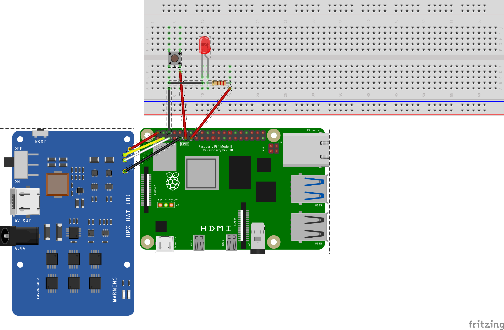
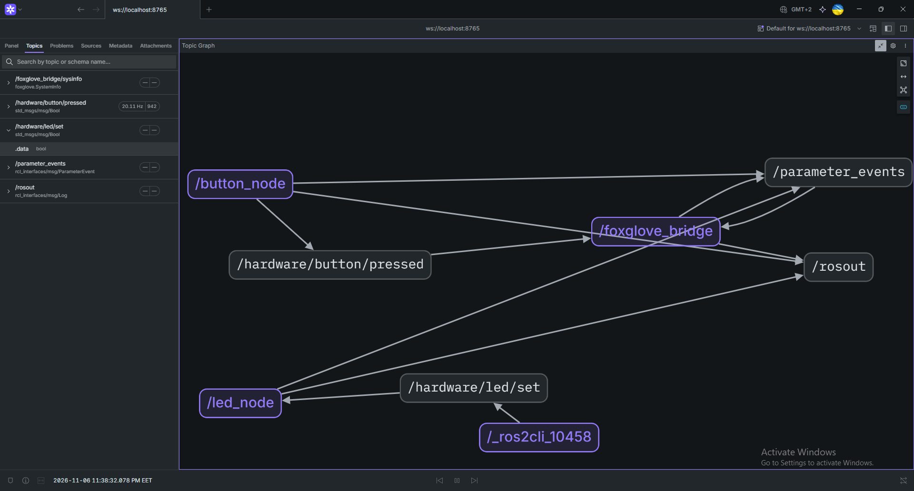
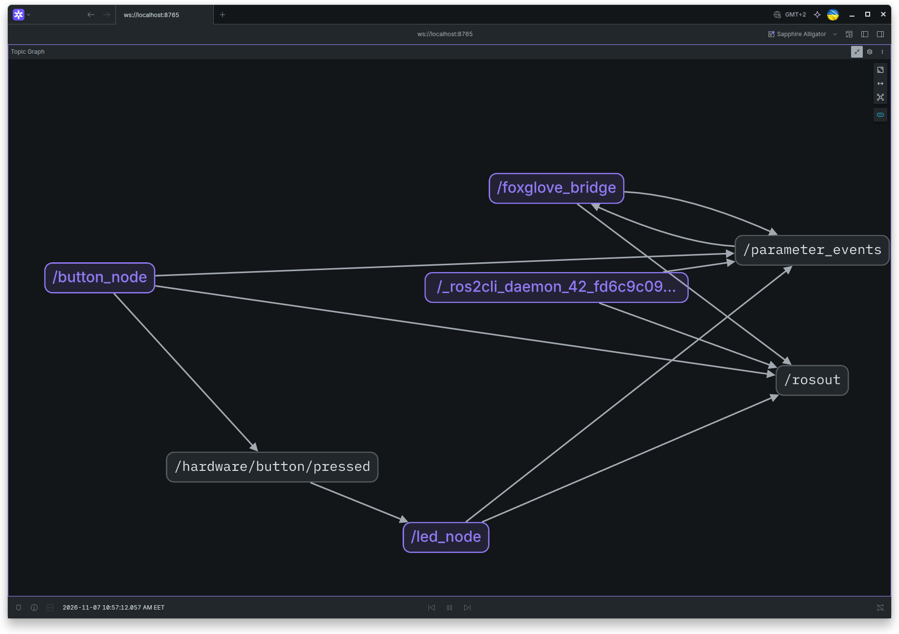
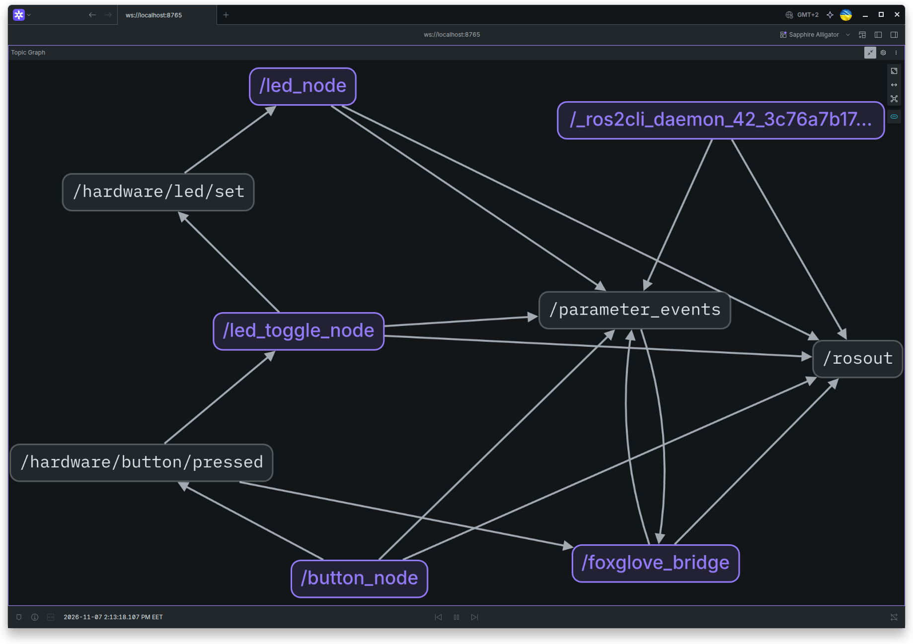

## Basic `gpiod` utils

|command | destination| example|
|--------|------------|--------|
|gpiodetect|find available GPIO-controllers| gpiodetect|
|gpioinfo| view GPIO configuration and usage| gpioinfo -c gpiochip0 # for all chip   gpioinfo -c gpiochip0 17 # for GPIO17 pin |
|gpoiget| read GPIO value| gpioget -c gpiochip0 -b pull-up --numeric 27 | 
|gpioset|set GPIO value| gpioset -c gpiochip0 27=1 # on  gpioset -c gpiochip0 27=0 # off gpioset -c gpiochip0 -t 500ms 27=1 # change state eveery 500 ms (Led blinking as result)
|gpiomon|monitor signal changes (edge events)| gpiomon -c gpiochip0 -b pull-up -e both 17  gpiomon -c gpiochip0 -b pull-up -e both -p 30ms 17
|gpionotify|monitor GPIO configuration settings|
___

add `pkg-config \` то `apt-install` to command in Dockerfile and rebuild image using cache:

    docker compose up -d --build

make shure `GPIO17` and `GPIO27` are not used by other components or nodes:

    ros@rpi:/ros2-ws$ gpioget -c gpiochip0 --bias=pull-up 17
    "17"=active
    ros@rpi:/ros2-ws$ gpioget -c gpiochip0 --bias=pull-up 27
    "27"=active

start [`gpio_driver` `led_node`](../../ros2-ws/src/lessons/lesson_04/gpio_driver/src/led_node.cpp) and check manually:

<pre>
ros@rpi:/ros2-ws$ ros2 topic list
/hardware/led/set
/parameter_events
/rosout

ros@rpi:/ros2-ws$ ros2 topic list -t
/hardware/led/set [std_msgs/msg/Bool]
/parameter_events [rcl_interfaces/msg/ParameterEvent]
/rosout [rcl_interfaces/msg/Log]

ros@rpi:/ros2-ws$ ros2 interface show std_msgs/msg/Bool
# This was originally provided as an example message.
# It is deprecated as of Foxy
# It is recommended to create your own semantically meaningful message.
# However if you would like to continue using this please use the equivalent in example_msgs.

bool data

ros@rpi:/ros2-ws$ ros2 topic pub --once  /hardware/led/set std_msgs/msg/Bool "{data: true}"
publisher: beginning loop
publishing #1: std_msgs.msg.Bool(data=True)  # led lit up

ros@rpi:/ros2-ws$ ros2 topic pub --once  /hardware/led/set std_msgs/msg/Bool "{data: false}"
publisher: beginning loop
publishing #1: std_msgs.msg.Bool(data=False)  # led went out
</pre>

start [`button_node`](../../ros2-ws/src/lessons/lesson_04/gpio_driver/src/button_node.cpp) and pres the button few times:

    ros@rpi:/ros2-ws$ ros2 run gpio_driver button_node
    [INFO] [1794000869.660411012] [button_node]: Button GPIO ready at line GPIO17
    [INFO] [1794000874.845587522] [button_node]: button state chenged to pressed
    [INFO] [1794000875.725553006] [button_node]: button state chenged to released

checkout Foxglove:

[lesson04_foxglove_led_and_button_nodes](lesson04_led_buttons_gpio_physical_nodes.md) 

We can see both nodes with their topics, but they don't interract in any way. Apply **remapping**:

    ros@rpi:/ros2-ws$ ros2 run gpio_driver led_node --ros-args -r /hardware/led/set:=/hardware/button/pressed
    [INFO] [1794041742.920347261] [led_node]: LED GPIO READY at line GPIO27

and check `Foxglove Topic Graph` or `RQt graph` if you use it.

Now led_node subscribed on `hardware/button/pressed` topic, instead of her default `/hardware/led/set` topic. And the LED is lit up while the button is pressed and went out when button is realesed.

Create [`led_toggle_node`](../../ros2-ws/src/lessons/lesson_04/gpio_control/src/led_toggle_node.cpp). We add relative topics names as topics for publisher and subscriber. It allow us to simple reuse toggle node via **remapping** names using `--ros-args -r <old_name>:=<new_name>` command:

    ros@rpi:/ros2-ws$ ros2 run gpio_control led_toggle --ros-args \
    -r button_state:=/hardware/button/pressed \ 
    -r set_led:=/hardware/led/set
    [INFO] [1794053337.442173181] [led_toggle_node]: initialized
    [INFO] [1794053357.676337663] [led_toggle_node]: switch LED off -> on # LED lit up on realise
    [INFO] [1794053359.475968185] [led_toggle_node]: switch LED on -> off # LED went out on realise

Topic Graph:

add **failsafe**: if signal lost - set led line to `INACTIVE` value:

    terminal 1:
    ros@rpi:/ros2-ws$ ros2 topic pub -r 0.2 /hardware/led/set std_msgs/msg/Bool "{data: true}"
    
    terminal with running led_node log:
    [INFO] [1794058506.225127946] [led_node]: signal restored 
    [WARN] [1794058508.301870870] [led_node]: FAILSAFE: no commanf for 2 seconds 
    line GPIO27 switched to INACTIVE 
    [INFO] [1794058511.227926171] [led_node]: signal restored
    [WARN] [1794058513.301894952] [led_node]: FAILSAFE: no commanf for 2 seconds
    line GPIO27 switched to INACTIVE

### bug :(
if the **button node** stops working while the **LED is turn on** - the **toggle node** will continue sending the `true` signal to the **led dode** so the LED will stay turning in and we can not turn off it via button pressing. Also after `led_node` stopping the led will went out but after relaunching - `led_node` - it will lit on again - because the `toggle led node` is still sending old state  of dumped `button_node`. And finnaly after relaunching of `toggle led node` our system will be working good. Also shutting down of the `led_node` set line controlled by it to `INACTIVE` - it implemented in LedNode destructor, but this bechavior is just software pacifier and it not peovides 100 waranty of setting up line to INACTIVE valuse. 

**Cmmon Solution**: we must implement `watchdog timer` in all nodes that subscrivbed on command topics. It brings us to the point of what is more convenient to implement two things:

1. change `std_msg/msg/Bool` to custom interface with `timestamp` and `data` fields. May be also some another filelds like DTO objects has.
2. It willl be usefull to have some `WathcdogTimer` class, that getting safe interval, and reporting if we need apply failsafe actions.

So ideally we need to hawe hardware pacifiers if we working with real staff.

Solved: add `watchdog` to publisher timer. If the last msg time is greater than the timeout,  we reset states to `false` and send this value to subscribers until the topic publisher restored. When all components and nodes are functioning normlly - the LED will remain off until the button is pressed, as safety conditions.