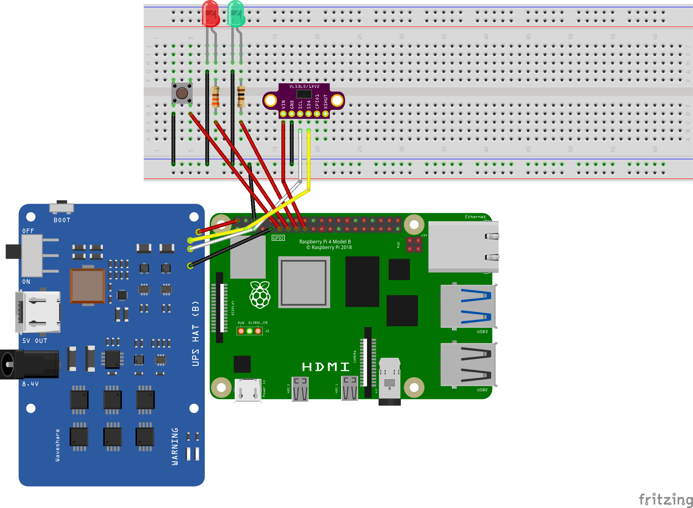
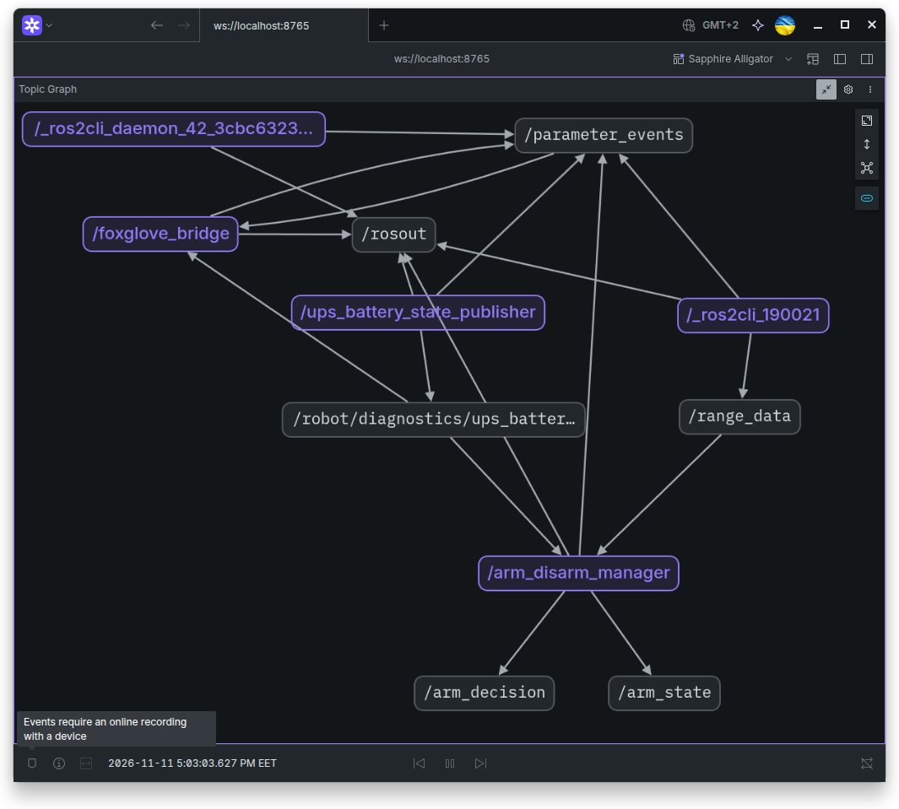
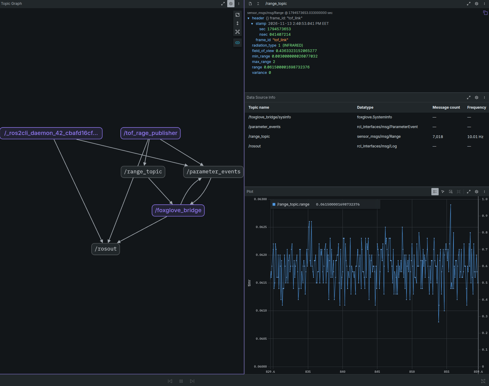

## Breadboard 

### check connections and pins
we know that the gpiochip name is `gpiochip0` from previous lesson

 check button:

    ros@rpi:/ros2-ws$ gpioget -c gpiochip0 -b pull-up 17
    "17"=active
    ros@rpi:/ros2-ws$ gpioget -c gpiochip0 -b pull-up 17
    "17"=inactive

check **red LED** at `GPIO27`:

    ros@rpi:/ros2-ws$ gpioset -c gpiochip0 27=1  # lit up
    ^C
    ros@rpi:/ros2-ws$ gpioset -c gpiochip0 27=0  # went out
    ^C

check **green LED** at `GPIO22`:

    ros@rpi:/ros2-ws$ gpioset -c gpiochip0 22=1  # lit up
    ^C
    ros@rpi:/ros2-ws$ gpioset -c gpiochip0 22=0  # went out
    ^C

check **range sensor** at `I2C bus`:

<pre>
ros@rpi:/ros2-ws$ i2cdetect -y 1
     0  1  2  3  4  5  6  7  8  9  a  b  c  d  e  f
00:                         -- -- -- -- -- -- -- -- 
10: -- -- -- -- -- -- -- -- -- -- -- -- -- -- -- -- 
20: -- -- -- -- -- -- -- -- -- 29 -- -- -- -- -- -- 
30: -- -- -- -- -- -- -- -- -- -- -- -- -- -- -- -- 
40: -- -- 42 -- -- -- -- -- -- -- -- -- -- -- -- -- 
50: -- -- -- -- -- -- -- -- -- -- -- -- -- -- -- -- 
60: -- -- -- -- -- -- -- -- -- -- -- -- -- -- -- -- 
70: -- -- -- -- -- -- -- --     
</pre>                    

tof sensor is at 0x29 as expected.

**Bradboard connection is correct. All components are working as expected.**

# Interfaces
after building  [safety_interfaces](../../ros2-ws/src/lessons/lesson_5.1/safety_interfaces) package check them:
<pre>
ros@rpi:/ros2-ws$ ros2 interface list | grep safety_interfaces
    safety_interfaces/msg/ArmDecision
    safety_interfaces/msg/ArmState
    safety_interfaces/msg/ButtonState
    safety_interfaces/msg/LedCommand
    safety_interfaces/srv/SetArm

ros@rpi:/ros2-ws$ ros2 interface show safety_interfaces/msg/ArmState
uint8 STANDBY=0
uint8 ARMED=1

builtin_interfaces/Time stamp
	int32 sec
	uint32 nanosec
uint8 state
uint32 revision
# revision incrases by 1 at each state chage

ros@rpi:/ros2-ws$ ros2 interface show safety_interfaces/srv/SetArm 
uint8 ARM=1
uint8 DISARM=2

uint8 command

---

safety_interfaces/ArmDecision decision
	uint8 OK=0
	uint8 INVALID_COMMAND=1
	uint8 UPS_UNAVAILABLE=2
	uint8 UPS_INVALID=3
	uint8 LOW_VOLTAGE=4
	uint8 RANGE_SENSOR_UNAVAILABLE=5
	uint8 RANGE_SENSOR_INVALID=6
	uint8 OBSTACLE_TOO_CLOSE=7
	uint8 INTERNAL_ERROR=8
	builtin_interfaces/Time stamp
		int32 sec
		uint32 nanosec
	uint8 command
	bool accepted
	uint8 reason
	string detail
safety_interfaces/ArmState state
	uint8 STANDBY=0
	uint8 ARMED=1
	builtin_interfaces/Time stamp
		int32 sec
		uint32 nanosec
	uint8 state
	uint32 revision
</pre>

### ! Breaking Change - created [course_utils](../../ros2-ws/src/course_utils) package and [debouncer.hpp](../../ros2-ws/src/course_utils/include/course_utils/debouncer.hpp) file from [lesson04/gpio_driver](../../ros2-ws/src/lessons/lesson_04/gpio_driver) package moved there. 

### **! NOTE**: 
in this lesson we are not implement any parameter validation logic. We can make custom function and throw it to `add_pre_set_parameters_callback` for fallback, to `add_on_set_parameters_callback` for accepting or rejecting as callback but this is not a lesson topic at all. We loockup the  `generate_parameter_library` tool at next lessons.

# [arm_disarm_manager](../../ros2-ws/src/lessons/lesson_5.1/controllers/arming_manager/src/arm_disarm_manager.cpp)
build and install package. Check node with exisiting [battery state publisher](../../ros2-ws/src/lessons/lesson_03/ups_monitor/ups_monitor/nodes/battery_publisher.py) and with syntetic msg that imitates a range sensor: 

**terminal 1:**

	ros@rpi:/ros2-ws$ ros2 run ups_monitor ups_battery_state_publisher 
	[INFO] [1794407810.150311179] [ups_battery_state_publisher]: INITIALIZED

**terminal 2:**
<pre>	
ros@rpi:/ros2-ws$ ros2 topic pub -r 5 \ 
	/range_data \ 
	sensor_msgs/msg/Range \
	"{header: auto, radiation_type: 1, field_of_view: 0.44, min_range: 0.03, max_range: 2.0, range: 0.5}"

publisher: beginning loop
publishing #1: sensor_msgs.msg.Range(header=std_msgs.msg.Header(stamp=builtin_interfaces.msg.Time(sec=1794407853, nanosec=143532804), frame_id=''), radiation_type=1, field_of_view=0.44, min_range=0.03, max_range=2.0, range=0.5, variance=0.0)

publishing #2: sensor_msgs.msg.Range(header=std_msgs.msg.Header(stamp=builtin_interfaces.msg.Time(sec=1794407853, nanosec=347173852), frame_id=''), radiation_type=1, field_of_view=0.44, min_range=0.03, max_range=2.0, range=0.5, variance=0.0)
</pre>

**terminal 3:**

<pre>
ros@rpi:/ros2-ws$ ros2 run arming_manager arm_disarm_manager \
	--ros-args -r /range_sensor_topic:=/range_data \
	-r /battery_state_topic:=/robot/diagnostics/ups_battery_state
[INFO] [1794408043.701906219] [arm_disarm_manager]: INITIALIZED
</pre>

in foxglove:

**telminal 4:** 

send arming request
<pre>
ros@rpi:/ros2-ws$ ros2 service call arm_manager safety_interfaces/srv/SetArm "{command: 1}"
requester: making request: safety_interfaces.srv.SetArm_Request(command=1)

response:
safety_interfaces.srv.SetArm_Response(decision=safety_interfaces.msg.ArmDecision(stamp=builtin_interfaces.msg.Time(sec=0, nanosec=0), command=1, accepted=False, reason=2, detail='battery state is unsafe'), state=safety_interfaces.msg.ArmState(stamp=builtin_interfaces.msg.Time(sec=1794408043, nanosec=679907282), state=0, revision=0))
</pre>

we got `accepted=False` with `reason=2`, `detail='battery state is unsafe'`
and from `arm_disarm_manager`:

	[ERROR] [1794408163.563533316] [arm_disarm_manager]: Sensor timestamp invalid: age=0.505 s, timeout=0.100 s
	[ERROR] [1794408163.563923144] [arm_disarm_manager]: battery state msg is too old

the reason is:
<pre>
class BatteryStatePublisher(Node):
    def __init__(self, battery_reader: IBatteryStatus) -> None:
        super().__init__("ups_battery_state_publisher")

        self._battery_reader = battery_reader

        self._publisher = self.create_publisher(BatteryState, TOPIC_NAME, 10)
        self._timer = self.create_timer(1.0, self.callback)  
        self.get_logger().info("INITIALIZED")
</pre>

**publishing is each one second but we thing that the state msg is too old if its age > 0.100 seconds**
also we dont create declared parameter in battery state publisher, so we can's change publishing frquency here. But we implemented parameter declaration in arm_disarm_manager, so change it:

	ros@rpi:/ros2-ws$ ros2 param set arm_disarm_manager heartbeat_timeout_ms 1500
	Set parameter successful

and try again:

	ros@rpi:/ros2-ws$ ros2 service call arm_manager safety_interfaces/srv/SetArm "{command: 1}"
	requester: making request: safety_interfaces.srv.SetArm_Request(command=1)

	response:
	safety_interfaces.srv.SetArm_Response(decision=safety_interfaces.msg.ArmDecision(stamp=builtin_interfaces.msg.Time(sec=0, nanosec=0), command=1, accepted=False, reason=5, detail='unconsistent range data'), state=safety_interfaces.msg.ArmState(stamp=builtin_interfaces.msg.Time(sec=1794408043, nanosec=679907282), state=0, revision=0))

got new negative decision and from `arm_disarm_manager`:

	[INFO] [1794408746.699644097] [arm_disarm_manager]: [OK] - msg age check
	[INFO] [1794408746.699828299] [arm_disarm_manager]: [OK] - battery check
	[ERROR] [1794408746.699905632] [arm_disarm_manager]: Sensor timestamp invalid: age=1794408746.700 s, timeout=1.500 s
	[ERROR] [1794408746.700072539] [arm_disarm_manager]: range sensor msg is too old

the reason is our syntethic data of `Range sensor` has stamp with no setted up time. Change it:

	ros@rpi:/ros2-ws$ ros2 topic pub -r 5 /range_data sensor_msgs/msg/Range   "{header: auto, radiation_type: 1, field_of_view: 0.44, min_range: 0.03, max_range: 2.0, range: 0.5}"
	publisher: beginning loop
	publishing #1: sensor_msgs.msg.Range(header=std_msgs.msg.Header(stamp=builtin_interfaces.msg.Time(sec=1794408955, nanosec=518027334), frame_id=''), radiation_type=1, field_of_view=0.44, min_range=0.03, max_range=2.0, range=0.5, variance=0.0)

try set ARM again:
	ros@rpi:/ros2-ws$ ros2 service call arm_manager safety_interfaces/srv/SetArm "{command: 1}"
	requester: making request: safety_interfaces.srv.SetArm_Request(command=1)

	response:
	safety_interfaces.srv.SetArm_Response(decision=safety_interfaces.msg.ArmDecision(stamp=builtin_interfaces.msg.Time(sec=0, nanosec=0), command=1, accepted=True, reason=0, detail='ARM accepted'), state=safety_interfaces.msg.ArmState(stamp=builtin_interfaces.msg.Time(sec=1794409031, nanosec=512763554), state=1, revision=1))
and arm_disarm_manager logger:

<pre>
[INFO] [1794409031.512445611] [arm_disarm_manager]: [OK] - msg age check
[INFO] [1794409031.512630703] [arm_disarm_manager]: [OK] - battery check
[INFO] [1794409031.512683684] [arm_disarm_manager]: [OK] - msg age check
[INFO] [1794409031.512724277] [arm_disarm_manager]: [OK] range check
[INFO] [1794409031.512807739] [arm_disarm_manager]: arm state updated: 
stamp:
  sec: 1794409031
  nanosec: 512763554
state: 1
revision: 1
</pre>

# add ToF driver from external source
add to `Dockerfile` run command python dev tools:

    # dev tools
    python3-venv \
    python3-colcon-common-extensions \
    python3-rosdep \
    python3-argcomplete \

and add `python venv`:

	# Shared Python environment for additional PyPI packages
	RUN python3 -m venv --system-site-packages /opt/robot-venv \
		&& /opt/robot-venv/bin/python -m pip install --no-cache-dir \
			adafruit-circuitpython-vl53l0x \
			adafruit-extended-bus

rebuild container

	docker compose -f compose.yml up -d --build

check:

	ros@ros2-pi:/ros2-ws$ which python3
	/usr/bin/python3

we use system envoirement. Now check ToF driver (installed in robot-venv) and rclcpp (installed in system venv):

	/opt/robot-venv/bin/python3 -c "
	import rclpy
	import cv2
	import gpiozero
	import adafruit_vl53l0x
	from adafruit_extended_bus import ExtendedI2C
	print('All imports OK')
	"

	>>> All imports OK

warning *"adafruit_vl53l0x" is not accessedPylance* when `import adafruit_vl53l0x` the reason is by default we use system interpreter? so we need change it to `robot-venv`:

1. Ctrl + Shift + P.
2. type Python: Select Interpreter.
3. choose Enter interpreter path.
4. type: `/opt/robot-venv/bin/python3`

and fix it in `/ros2-ws/.vscode/settings.json`, add:

	{
		"python.defaultInterpreterPath": "/opt/robot-venv/bin/python3",
		"python.analysis.extraPaths": [
			"/opt/ros/lyrical/lib/python3.14/site-packages"
		]
	}

first independent node run:

	ros@ros2-pi:/ros2-ws$ /opt/robot-venv/bin/python3 -m tof_sensor.tof_sensor_range_pub

	[INFO] [1794573548.662601799] [tof_rage_publisher]: initialized

in foxglove:

as we can see еру sensor messures вшіефтсу with certain degree of variablility, therefore such mesurements should be approximated. But we don't do this in the current node/ This node will braodcast a raw range.

launching some nodes via `ros2 run` while running others within a `venv` envoirement is not very convenient. In general, launching individual nodes in separate terminals is no the best approach. Therefore, moving forward we will use **`Launch files`**

with [launch file](../../../../../ros2-ws/src/lessons/lesson_5.1/hardware/sensors/range/tof_sensor/tof_sensor/launch/tof_sensor.launch.py) node launching becomes simple again:

	ros@ros2-pi:/ros2-ws$ ros2 launch tof_sensor tof_sensor.launch.py 
	
	[INFO] [launch]: All log files can be found below /home/ros/.ros/log/2026-11-13-13-09-20-006756-ros2-pi-133455
	[INFO] [launch]: Default logging verbosity is set to INFO
	[INFO] [python3-1]: process started with pid [133532]
	[python3-1] /opt/robot-venv/lib/python3.14/site-packages/adafruit_blinka/microcontroller/generic_linux/i2c.py:30: RuntimeWarning: I2C frequency is not settable in python, ignoring!
	[python3-1]   warnings.warn(
	[python3-1] [INFO] [1794575362.838803097] [tof_raw_range]: initialized