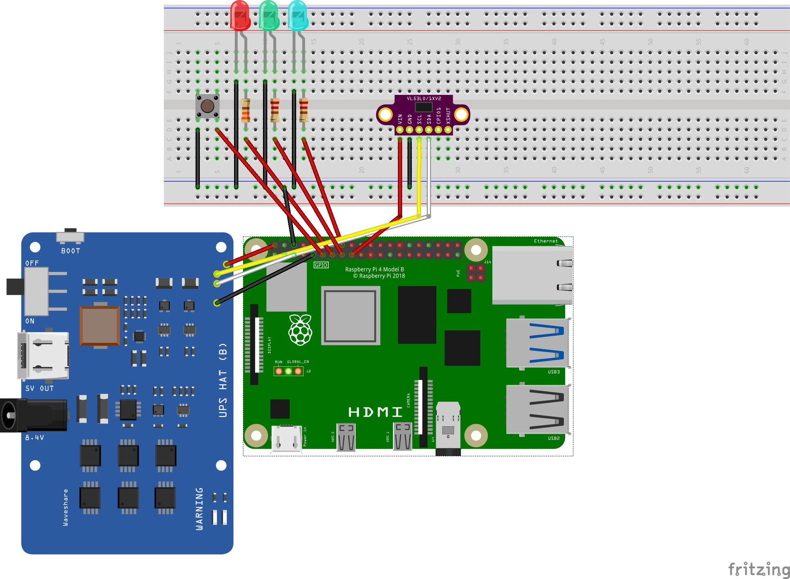
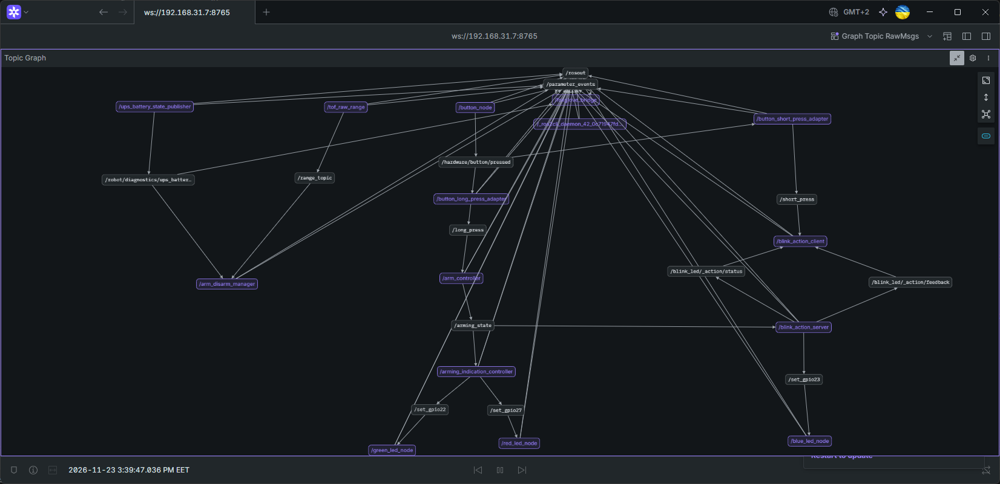

# Breadboard
add blue LED on `GPIO23`


# Check connections
full check of `GPIO` pins and `I2C ToF` sensor connection is in lesson 4: [click](lesson04_led_buttons_gpio_physical_nodes.md)

We have just connected a blue LED to GPIO23,  as shown in the breadbord circuit. Check it:

```bash
gpioset -c gpiochip0 23=1 # The blue LED is lit 
^C
gpioset -c gpiochip0 23=0 # The blue LED is not lit
^C

```


# Architecture


# Interfaces

Since this lesson is a continuation of Lesson 5.1, we will add the `action` interface to the `lesson5.1/interfaces/system_interfaces` package to avoid duplicating packages that are semantically identical.

Build. Install. Check:
```bash
ros2 interface list | grep system_interfaces
```


````bash
# system_interfaces/msg/ArmingState
# system_interfaces/action/BlinkLed
````

```bash
ros2 interface show system_interfaces/action/BlinkLed 
```
```bash
# GOAL
# one cycle is OFF->ON state change sequence
uint32 cycles
uint32 half_preiod_ms
---
# RESULT
uint32 complited_cycles
---
# FEEDBACK
uint32 complited_cycles
bool led_on
```

# ButtonShortPressAdapter

Create a package in the adapters directory. Also implement **blink_system launch** and add the adapter node. Build. Source. Check:

```bash
ros2 launch lesson_05_bringup blink_system.launch.py
```

```bash
[INFO] [launch]: All log files can be found below /home/ros/.ros/log/2026-11-18-14-15-01-516081-ros2-pi-154233
[INFO] [launch]: Default logging verbosity is set to INFO
[INFO] [button_short_press_adapter-1]: process started with pid [154283]
[button_short_press_adapter-1] [INFO] [1795011302.278247165] [button_short_press_adapter]: INITIALIZED

# short press <= 500 ms
[button_short_press_adapter-1] [INFO] [1795011307.907340119] [button_short_press_adapter]: Button is pressed
[button_short_press_adapter-1] [INFO] [1795011308.006953562] [button_short_press_adapter]: button is realised. Ellapsed 0.099612 seconds
[button_short_press_adapter-1] [INFO] [1795011308.007453653] [button_short_press_adapter]: Publishing short press
# not short press > 500 ms
[button_short_press_adapter-1] [INFO] [1795011310.707047472] [button_short_press_adapter]: Button is pressed
[button_short_press_adapter-1] [INFO] [1795011312.206969256] [button_short_press_adapter]: button is realised. Ellapsed 1.499919 seconds
# long press > 3000 ms
[button_short_press_adapter-1] [INFO] [1795011318.306894147] [button_short_press_adapter]: Button is pressed
[button_short_press_adapter-1] [INFO] [1795011322.106890706] [button_short_press_adapter]: button is realised. Ellapsed 3.799995 seconds
# one more short press < 500 ms
[button_short_press_adapter-1] [INFO] [1795011327.807330886] [button_short_press_adapter]: Button is pressed
[button_short_press_adapter-1] [INFO] [1795011328.106926118] [button_short_press_adapter]: button is realised. Ellapsed 0.299594 seconds
[button_short_press_adapter-1] [INFO] [1795011328.107760800] [button_short_press_adapter]: Publishing short press
```

# Action Server
run server:
```bash
ros2 run blink_control blink_action_server --ros-args -p gpio_line:=23
```
check interfaces:
```bash
ros2 action list -t
ros2 action info /blink_led
ros2 action type /blink_led
ros2 interface show system_interfaces/action/BlinkLed
```

To test action server we need to do a few things: 
1. we need to obtain the ArmingStae, so launch arm system:
```bash
ros2 launch lesson_05_bringup arm_system.launch.py 
```
2. and now we can controll the blue LED instead of receiving  an echo. To do this we need to launch another `LED driver` remmaped to the gpioline 23 topic with the line parameter set to 23:
```bash
ros2 run gpio_driver led_node --ros-args -r /hardware/led/set:=/set_gpio23 -p line:=23
```

in separate terminal send:
```bash
ros2 action send_goal \
  /blink_led \
  system_interfaces/action/BlinkLed \
  "{cycles: 20, half_preiod_ms: 250}" \
  --feedback
```

if the system is armed we will see blue led blinked, and action server log:
```bash
[INFO] [1795349427.622958870] [blink_action_server]: INITIALIZED
[INFO] [1795349888.579061766] [blink_action_server]: Goal accepted!
[INFO] [1795349888.579224154] [blink_action_server]: Goal accepted: cycles=20, half_period=250 ms
[INFO] [1795349888.581194811] [blink_action_server]: Blink execution started. Goal: 20 cycles
[INFO] [1795349898.599934401] [blink_action_server]: Goal SUCCESSED. 20 completed cycles
```
so now we can ty different cases like run at disarmed system [reject], disarm while action executing [aborted], send new action while current action executing [reject].

Add action server and led driver node to [blink system launch file](../../../../../ros2-ws/src/lessons/lesson_5/lesson_05_bringup/launch/blink_system.launch.py). Build the package. Now we can launch all blink system nodes by simple command:
```bash
ros2 launch  lesson_05_bringup blink_system.launch.py
```
# Action Client
in `IDLE` state action client will send a target to server and chenge the state. In not `ACTIVE` state it`s must to send cancel_request to server. Add action server node to [blink_system.launch.py](../../../../../ros2-ws/src/lessons/lesson_5/lesson_05_bringup/launch/blink_system.launch.py) file. Re-build [lesson_05_bringup](../../../../../ros2-ws/src/lessons/lesson_5/lesson_05_bringup) and [blink_control](../../../../../ros2-ws/src/lessons/lesson_5/blink_control) packages.

**terminal 1:**
```bash
ros2 launch lesson_05_bringup arm_system.launch.py
```
**terminal 2**
```bash
ros2 launch lesson_05_bringup blink_system.launch.py half_period_ms:=1000 
```

Check cases

|Conditions | arm system log | blink sysytem log | result|
|-----------|----------------|-------------------|-------|
|system `DISARMED`|<pre>[button_long_press_adapter-6] [INFO] [1795442847.015008475] [button_long_press_adapter]: button pushed<br>[button_long_press_adapter-6] [INFO] [1795442847.214883942] [button_long_press_adapter]: Button realised to early: 0.199828 s</pre>|<pre>[button_short_press_adapter-1] [INFO] [1795442847.015013438] [button_short_press_adapter]: Button is pressed<br>[button_short_press_adapter-1] [INFO] [1795442847.214911553] [button_short_press_adapter]: button is realised. Ellapsed 0.199896 seconds<br>[button_short_press_adapter-1] [INFO] [1795442847.215429107] [button_short_press_adapter]: Publishing short press<br>[blink_action_client-4] [INFO] [1795442847.217640935] [blink_action_client]: Sending goal: cycles = 20, time_period_ms = 1000<br>[blink_action_server-3] [WARN] [1795442847.218827487] [blink_action_server]: [REJECTED] system is not ready<br>[blink_action_client-4] [ERROR] [1795442847.220255039] [blink_action_client]: Goal was rejected by server</pre>| Blue LED stay turned off |
| sysytem `ARMED`| <pre>[button_long_press_adapter-6] [INFO] [1795444344.484013868] [button_long_press_adapter]: button pushed<br>[button_node-1] [INFO] [1795444344.598494294] [button_node]: button state chenged to released<br>[button_long_press_adapter-6] [INFO] [1795444344.684009916] [button_long_press_adapter]: Button realised to early: 0.199974 s</pre>| <pre>[button_short_press_adapter-1] [INFO] [1795444344.483999312] [button_short_press_adapter]: Button is pressed<br>[button_short_press_adapter-1] [INFO] [1795444344.684465711] [button_short_press_adapter]: button is realised. Ellapsed 0.200465 seconds<br>[button_short_press_adapter-1] [INFO] [1795444344.684805006] [button_short_press_adapter]: Publishing short press<br>[blink_action_client-4] [INFO] [1795444344.685703633] [blink_action_client]: Sending goal: cycles = 20, time_period_ms = 1000<br>[blink_action_server-3] [INFO] [1795444344.689787770] [blink_action_server]: Goal accepted!<br>[blink_action_server-3] [INFO] [1795444344.690315842] [blink_action_server]: Goal accepted: cycles=20, half_period=1000 ms<br>[blink_action_server-3] [INFO] [1795444344.693831591] [blink_action_server]: Blink execution started. Goal: 20 cycles<br>[led_node-2] [INFO] [1795444344.695912011] [blue_led_node]: signal restored<br>[blink_action_client-4] [INFO] [1795444346.696273329] [blink_action_client]: FEEDBACK: 1 cycles completed<br>[blink_action_client-4] [INFO] [1795444348.696920813] [blink_action_client]: FEEDBACK: 2 cycles completed<br>...<br>[blink_action_client-4] [INFO] [1795444382.713513834] [blink_action_client]: FEEDBACK: 19 cycles completed<br>[blink_action_server-3] [INFO] [1795444384.715934183] [blink_action_server]: Goal SUCCESSED. 20 completed cycles<br>[blink_action_client-4] [INFO] [1795444384.717199809] [blink_action_client]: FEEDBACK: 20 cycles completed<br>[blink_action_client-4] [INFO] [1795444384.717811863] [blink_action_client]: SUCCEEDED 20 cycles completed<br>[led_node-2] [WARN] [1795444386.732810194] [blue_led_node]: FAILSAFE: no commanf for 2 seconds<br>[led_node-2] line GPIO23 switched to INACTIVE</pre>| LED Blinked 20 times|
|`ARMED`, Goal is active, short press| <pre>[button_long_press_adapter-6] [INFO] [1795444688.784383543] [button_long_press_adapter]: button pushed<br>[button_node-1] [INFO] [1795444688.958512265] [button_node]: button state chenged to released<br>[button_long_press_adapter-6] [INFO] [1795444688.984001768] [button_long_press_adapter]: Button realised to early: 0.199603 s</pre>| <pre>...<br>[blink_action_client-4] [INFO] [1795444687.499305470] [blink_action_client]: FEEDBACK: 3 cycles completed<br>[button_short_press_adapter-1] [INFO] [1795444688.783980322] [button_short_press_adapter]: Button is pressed<br>[button_short_press_adapter-1] [INFO] [1795444688.983989565] [button_short_press_adapter]: button is realised. Ellapsed 0.200007 seconds<br>[button_short_press_adapter-1] [INFO] [1795444688.984359767] [button_short_press_adapter]: Publishing short press<br>[blink_action_client-4] [INFO] [1795444688.992405208] [blink_action_client]: Goal cangel requested<br>[blink_action_server-3] [INFO] [1795444688.996560808] [blink_action_server]: Cancel request recived<br>[blink_action_client-4] [INFO] [1795444688.997626805] [blink_action_client]: CANCELED 3 cycles completed<br>[blink_action_server-3] [INFO] [1795444688.998035544] [blink_action_server]: Goal CAMCELED. 3 cycles completed</pre>| LED stop blinking|
|`ARMED`, Goal is active, `DSIARM` sysyem|<pre>[button_long_press_adapter-6] [INFO] [1795445047.987917101] [button_long_press_adapter]: button pushed<br>[button_long_press_adapter-6] [INFO] [1795445051.087970375] [button_long_press_adapter]: button pressed for 3.100032 seconds. Publishing long_press<br>[arm_controller-8] [INFO] [1795445051.088805482] [arm_controller]: sending request to approve ARM -> DISARM<br>[arm_controller-8] [INFO] [1795445051.091047730] [arm_controller]: ARM/DISARM response:<br>[arm_controller-8] stamp:<br>[arm_controller-8]   sec: 1795445051<br>[arm_controller-8]   nanosec: 89961291<br>[arm_controller-8] command: 0<br>[arm_controller-8] accepted: true<br>[arm_controller-8] reason: 0<br>[arm_controller-8] detail: "DISARM accepted"<br>[arm_controller-8]<br>[arm_controller-8] [INFO] [1795445051.091295433] [arm_controller]: current state:<br>[arm_controller-8] stamp:<br>[arm_controller-8]   sec: 1795445051<br>[arm_controller-8]   nanosec: 91260174<br>[arm_controller-8] state: 0<br>[arm_controller-8] revision: 2<br>[arm_controller-8]<br>[button_node-1] [INFO] [1795445052.857355155] [button_node]: button state chenged to released</pre>|<pre>...<br>[blink_action_client-4] [INFO] [1795445046.696971416] [blink_action_client]: FEEDBACK: 3 cycles completed<br>[button_short_press_adapter-1] [INFO] [1795445047.987887194] [button_short_press_adapter]: Button is pressed<br>[blink_action_client-4] [INFO] [1795445048.697733929] [blink_action_client]: FEEDBACK: 4 cycles completed<br>[blink_action_client-4] [INFO] [1795445050.698301722] [blink_action_client]: FEEDBACK: 5 cycles completed<br>[blink_action_server-3] [INFO] [1795445051.094899508] [blink_action_server]: System DISARMED!<br>[blink_action_server-3] [WARN] [1795445051.097925531] [blink_action_server]: Goal ABORTED. 5 completed cycles<br>[blink_action_client-4] [WARN] [1795445051.098731045] [blink_action_client]: ABORTED. 5 cycles completed<br>[button_short_press_adapter-1] [INFO] [1795445052.888318265] [button_short_press_adapter]: button is realised. Ellapsed 4.900429 seconds</pre>| LED stpot blinking, RED LED turn on|


As we can see, it works as expected.
# Foxglove Graph

